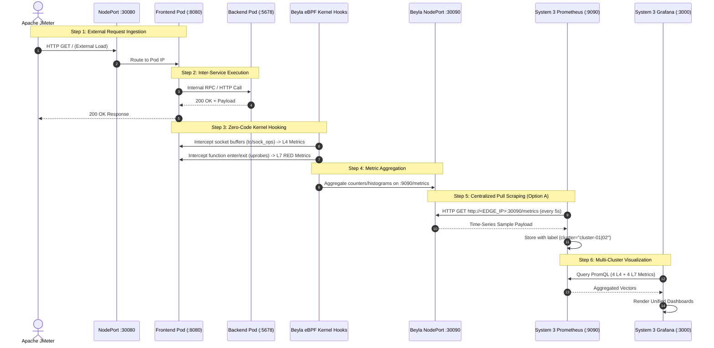

# Centralized Multi-Cluster Kubernetes Observability (CMCKO)
## Complete Architecture & End-to-End Data Flow Specification

This document serves as the **single source of truth** for the CMCKO 3-system distributed architecture, outlining the complete lifecycle from kernel-level eBPF packet inspection to centralized Prometheus scraping and multi-cluster Grafana visualization.

---

## 1. System Topology Overview

The architecture distributes responsibilities across **three physical/virtual machines** interconnected via a standard local area network (LAN / Wi-Fi):

```
                        ┌──────────────────────────────────────────────┐
                        │          EXTERNAL TRAFFIC GENERATOR          │
                        │           Apache JMeter (Client PC)          │
                        └───────┬──────────────────────────────┬───────┘
                                │                              │
                  HTTP GET /    │                              │ HTTP GET /
                  Port :30080   ▼                              ▼ Port :30080
    ┌─────────────────────────────────────────┐  ┌─────────────────────────────────────────┐
    │     SYSTEM 1: DATA PRODUCER (macOS)     │  │    SYSTEM 2: DATA PRODUCER (WSL2 k3s)   │
    │  • OS: macOS Apple Silicon (OrbStack)   │  │  • OS: Windows 10/11 WSL2 Ubuntu (k3s)  │
    │  • Cluster: cluster-01                  │  │  • Cluster: cluster-02                  │
    │                                         │  │                                         │
    │  [Pod Workloads]                        │  │  [Pod Workloads]                        │
    │  - frontend (:8080) [NodePort :30080]   │  │  - frontend (:8080) [NodePort :30080]   │
    │  - backend  (:5678) [ClusterIP]         │  │  - backend  (:5678) [ClusterIP]         │
    │  - auth     (:7070) [ClusterIP]         │  │  - auth     (:7070) [ClusterIP]         │
    │  *(internal traffic-gen: replicas: 0)*  │  │  *(internal traffic-gen: replicas: 0)*  │
    │                                         │  │                                         │
    │  [Telemetry Engine]                     │  │  [Telemetry Engine]                     │
    │  - Grafana Beyla eBPF DaemonSet         │  │  - Grafana Beyla eBPF DaemonSet         │
    │    • L4: Socket filters & TCP stats     │  │    • L4: Socket filters & TCP stats     │
    │    • L7: userspace uprobes (Go runtime) │  │    • L7: userspace uprobes (Go runtime) │
    │  - Exporter Service [NodePort :30090]   │  │  - Exporter Service [NodePort :30090]   │
    └────────────────────┬────────────────────┘  └────────────────────┬────────────────────┘
                         │                                            │
                         │ HTTP GET /metrics                          │ HTTP GET /metrics
                         │ Port :30090 (Pull every 5s)                │ Port :30090 (Pull every 5s)
                         └──────────────────────┬─────────────────────┘
                                                │
                                                ▼
                        ┌──────────────────────────────────────────────┐
                        │      SYSTEM 3: CENTRAL MONITORING HUB        │
                        │           (Windows WSL2 Environment)         │
                        │                                              │
                        │  [Prometheus Server - Port :9090]            │
                        │  • Scrapes System 1 at <MAC_IP>:30090        │
                        │    (Injected label: cluster="cluster-01")    │
                        │  • Scrapes System 2 at <WSL_IP>:30090        │
                        │    (Injected label: cluster="cluster-02")    │
                        │  • TSDB Time-Series Storage & Retention      │
                        │                                              │
                        │  [Grafana Dashboard Hub - Port :3000]        │
                        │  • Datasource: http://prometheus:9090        │
                        │  • Unified Multi-Cluster Observability Board │
                        │    - 4 Layer 4 (Network/Transport) Metrics   │
                        │    - 4 Layer 7 (Application/RED) Metrics     │
                        │    - Cross-Cluster Switcher & Comparison     │
                        └──────────────────────────────────────────────┘
```

---

## 2. Core Architecture Rules & Design Decisions

### Rule 1: Option A (Prometheus ONLY on System 3)
- **Zero Observability Footprint on Edge Clusters**: Systems 1 and 2 run **no** Prometheus servers, no Thanos sidecars, and no TSDB storage engines. They act strictly as **telemetry producers**.
- **Centralized Pull Model**: System 3 handles 100% of the metric polling, TSDB indexing, PromQL query computation, and dashboard rendering.

### Rule 2: Zero Application Code Instrumentation
- Target microservice containers (`frontend`, `backend`, `auth`) are stock, unmodified Go binaries (`hashicorp/http-echo`).
- No OpenTelemetry SDKs, no language agents, and no code edits are injected.
- Telemetry is passively gathered directly from Linux kernel hooks using **Grafana Beyla eBPF**.

### Rule 3: External Traffic Generation (Apache JMeter)
- The in-cluster mock generator (`traffic-gen`) is deactivated (`replicas: 0`).
- True external load (concurrency, think times, realistic HTTP requests, and intentional 4xx error paths) is injected via **Apache JMeter** hitting NodePort `30080`.

### Rule 4: Isolated Local Learning Subsystem (System 1)
- For personal study and offline validation, System 1 can optionally spin up local Prometheus and Grafana instances via `extras/local-learning-monitoring/`.
- This subsystem is completely decoupled from the production Option A pipeline and can be cleanly uninstalled at any time.

---

## 3. End-to-End Data Flow Steps



---

## 4. Detailed Telemetry Specification: The 4+4 Metrics

### Layer 4: Network & Transport Observability
Captured directly from Linux network sockets and TCP state transitions:

| # | Metric Name | Concept & Purpose | Kernel eBPF Hook | PromQL Metric Name | Triggered in JMeter By |
|---|---|---|---|---|---|
| **1** | **Network Throughput** | Bytes sent & received across cluster interfaces | Socket buffers / TC classifier | `befa_network_flow_bytes_total` | High thread count, large response bodies |
| **2** | **Active Connections** | Count of concurrent TCP sessions | `sock_ops` TCP state transitions | `befa_network_flow_stats` | Rapid connection opening / closing |
| **3** | **Packet Retransmissions** | Network packet loss & connection degradation | `tcp_retransmit_skb` tracepoint | `befa_network_flow_stats_tcp_retransmits_total` | Network congestion or traffic bursts |
| **4** | **Round-Trip Time (RTT)** | Kernel-level TCP round-trip latency | TCP socket RTT sampling | `befa_network_flow_stats_tcp_rtt_seconds` | TCP ACK response timing over LAN |

---

### Layer 7: Application & Service Observability (RED Method)
Captured via userspace eBPF uprobes attached to the application binary runtime:

| # | Metric Name | Concept & Purpose | Kernel eBPF Hook | PromQL Metric Name | Triggered in JMeter By |
|---|---|---|---|---|---|
| **1** | **Request Rate (Rate)** | HTTP requests per second (RPS) per route | `net/http` server entry uprobes | `http_server_request_duration_seconds_count` | Concurrency & JMeter Loop rate |
| **2** | **Latency (Duration)** | Response time percentiles (p50, p95, p99) | `net/http` return uprobes | `http_server_request_duration_seconds_bucket` | Think time, downstream service latency |
| **3** | **Error Rate (Errors)** | 4xx client and 5xx server HTTP failure rates | HTTP response status code inspector | `http_server_request_duration_seconds_count{http_response_status_code=~"[45].*"}` | `GET /api/unknown` intentional error sampler |
| **4** | **Payload Size** | Request & response byte volume per service | HTTP Content-Length & body parser | `http_server_request_body_size_bytes_sum` | Payload data transmitted |

---

## 5. Machine Breakdown & Port Mapping

| System | Role | Technology Stack | Inbound Ports | Outbound Access |
|---|---|---|---|---|
| **System 1** | Edge Cluster 01 | macOS M4, OrbStack, Kind | **30080** (JMeter target)<br>**30090** (Beyla /metrics) | None (passive target) |
| **System 2** | Edge Cluster 02 | Windows 10/11, WSL2 Ubuntu, k3s | **30080** (JMeter target)<br>**30090** (Beyla /metrics) | None (passive target) |
| **External** | Load Generator | Apache JMeter / Docker runner | *None* | Hits `http://<SYS1_IP>:30080`<br>Hits `http://<SYS2_IP>:30080` |
| **System 3** | Central Display Hub | Windows 10/11, WSL2, Docker Compose | **3000** (Grafana UI)<br>**9090** (Prometheus UI) | Scrapes `http://<SYS1_IP>:30090`<br>Scrapes `http://<SYS2_IP>:30090` |

---

## 6. Execution Command Reference

### On System 1 (macOS):
```bash
# 1. Deploy the edge cluster:
./scripts/deploy-system1-mac.sh

# 2. (Optional) Install local learning display if desired:
./extras/local-learning-monitoring/install.sh
```

### On System 2 (Windows WSL2):
```bash
# Deploy the edge cluster:
./scripts/setup-system2-wsl.sh
```

### On System 3 (Windows WSL2 Hub):
```bash
# 1. Update targets in system3-hub/prometheus.yml with System 1 & 2 LAN IPs
# 2. Launch the Central Hub:
cd system3-hub
docker compose up -d

# 3. Access Grafana:
http://localhost:3000 (admin / admin)
```

### From Traffic Generator:
```bash
# Run high-stress JMeter load against System 1 (0ms think time):
./jmeter/run-jmeter.sh <SYSTEM_1_IP> 30080 30 300 5 0

# Run high-stress JMeter load against System 2 (0ms think time):
./jmeter/run-jmeter.sh <SYSTEM_2_IP> 30080 30 300 5 0
```
