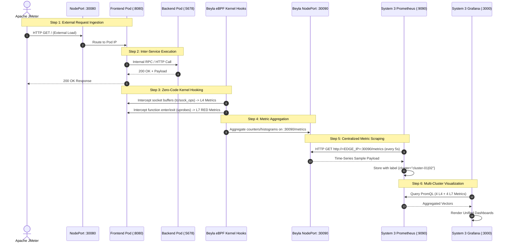

# CMCKO Architecture & End-to-End Data Flow Specification

This document outlines the architecture for the Centralized Multi-Cluster Kubernetes Observability (CMCKO) platform, detailing the end-to-end data flow: from kernel-level eBPF packet inspection and zero-code microservice uprobes, to centralized Prometheus metric collection and unified Grafana dashboard visualization.

---

## Key Design Principles

1. **Zero Instrumentation**: Microservices (`frontend`, `backend`, `auth`) are stock Go containers with no OpenTelemetry SDK, bytecode agents, or code modifications.
2. **Passive eBPF Tracing**: Grafana Beyla attaches non-intrusively to kernel tracepoints, socket operations (`sock_ops`, `tc`), and userspace uprobes.
3. **Lightweight Edge Nodes**: Edge clusters run no Prometheus TSDB engines, minimizing CPU and RAM overhead on production hosts.
4. **Realistic Load Testing**: In-cluster traffic generators are deactivated (`replicas: 0`). External load is driven via Apache JMeter hitting NodePort `30080` (simulating real-world traffic surges).
5. **Decoupled Local Observability**: A dedicated Prometheus and Grafana instance can be installed on System 1 (`monitoring/`) for direct verification and testing without interfering with external scrapers.

---

## 1. System Topology Overview

The architecture distributes responsibilities across machines interconnected via LAN or Tailscale:

```
                       ┌──────────────────────────────────────────────┐
                       │          EXTERNAL TRAFFIC GENERATOR          │
                       │           Apache JMeter (Client PC)          │
                       └───────┬──────────────────────────────┬───────┘
                               │                              │
                 HTTP GET /    │                              │ HTTP GET /
                 Port :30080   ▼                              ▼ Port :30080
   ┌─────────────────────────────────────────┐  ┌─────────────────────────────────────────┐
   │     SYSTEM 1: DATA PRODUCER (macOS)     │  │    SYSTEM 2: DATA PRODUCER (WSL2 k3s)   │
   │  • OS: macOS Apple Silicon (OrbStack)   │  │  • OS: Windows 10/11 WSL2 Ubuntu (k3s)  │
   │  • Cluster: cluster-01                  │  │  • Cluster: cluster-02                  │
   │                                         │  │                                         │
   │  [Pod Workloads - Namespace: demo]      │  │  [Pod Workloads - Namespace: demo]      │
   │  - frontend (:8080) [NodePort :30080]   │  │  - frontend (:8080) [NodePort :30080]   │
   │  - backend  (:5678) [ClusterIP]         │  │  - backend  (:5678) [ClusterIP]         │
   │  - auth     (:7070) [ClusterIP]         │  │  - auth     (:7070) [ClusterIP]         │
   │  - HPA: 1 -> 5 Replicas (Target 50% CPU)│  │                                         │
   │                                         │  │                                         │
   │  [Telemetry Engine]                     │  │  [Telemetry Engine]                     │
   │  - Grafana Beyla eBPF DaemonSet         │  │  - Grafana Beyla eBPF DaemonSet         │
   │    • L4: Socket filters & TCP stats     │  │    • L4: Socket filters & TCP stats     │
   │    • L7: userspace uprobes (Go runtime) │  │    • L7: userspace uprobes (Go runtime) │
   │  - Exporter Service [NodePort :30090]   │  │  - Exporter Service [NodePort :30090]   │
   └────────────────────┬────────────────────┘  └────────────────────┬────────────────────┘
                        │                                            │
                        │ HTTP GET /metrics                          │ HTTP GET /metrics
                        │ Port :30090 (Pull every 5s)                │ Port :30090 (Pull every 5s)
                        └──────────────────────┬─────────────────────┘
                                               │
                                               ▼
                       ┌──────────────────────────────────────────────┐
                       │      SYSTEM 3: CENTRAL MONITORING HUB        │
                       │           (Windows WSL2 Environment)         │
                       │                                              │
                       │  [Prometheus Server - Port :9090]            │
                       │  • Scrapes System 1 at <MAC_IP>:30090        │
                       │    (Injected label: cluster="cluster-01")    │
                       │  • Scrapes System 2 at <WSL_IP>:30090        │
                       │    (Injected label: cluster="cluster-02")    │
                       │  • TSDB Time-Series Storage & Retention      │
                       │                                              │
                       │  [Grafana Dashboard Hub - Port :3000]        │
                       │  • Datasource: http://prometheus:9090        │
                       │  • Unified Multi-Cluster Observability Board │
                       │    - 4 Layer 4 (Network/Transport) Metrics   │
                       │    - 4 Layer 7 (Application/RED) Metrics     │
                       │    - Cross-Cluster Switcher & Comparison     │
                       └──────────────────────────────────────────────┘
```

---

## 2. Core Architectural Decisions

### Centralized Pull Architecture
- **Zero Footprint on Edge Nodes**: Edge clusters run no Prometheus TSDB engines, remaining purely focused on workload execution.
- **Centralized Metrics Aggregation**: The central monitoring hub scrapes endpoints over HTTP (`:30090/metrics`) every 5 seconds, attaching appropriate cluster labels.

### Zero-Code Application Instrumentation
- Microservices (`frontend`, `backend`, `auth`) are standard Go binaries.
- No SDKs or language agents are required; all telemetry is gathered transparently from kernel tracepoints and uprobes via Grafana Beyla.

### External Load Generation
- Mock in-cluster load generation is disabled.
- Real HTTP load (concurrency, ramp-up, realistic think times) is delivered from outside the cluster via Apache JMeter.

### Local Observability on Edge Nodes
- System 1 includes a lightweight, modular Prometheus (`:30001`) and Grafana (`:30000`) stack via `monitoring/` for isolated verification and testing.

---

## 🔄 3. End-to-End Data Flow Steps



---

## 4. Telemetry Specification: 4 L4 and 4 L7 Metrics

### Layer 4: Network & Transport Observability
Captured directly from Linux network sockets, TCP state transitions, and node NIC interfaces:

| # | Metric Name | Concept & Purpose | Telemetry Source | Scraped PromQL Metric Name | Triggered in JMeter By |
|---|---|---|---|---|---|
| **1** | **Network Throughput** | Directional byte bandwidth (Sent vs Recv) across services | Socket buffers / TC classifier | `beyla_network_flow_bytes_total` | High thread count, large response bodies |
| **2** | **Active TCP Sockets** | Kernel-level active TCP sockets and memory table under load | Linux `sockstat` subsystem | `node_sockstat_TCP_inuse` | Concurrent HTTP/TCP connections |
| **3** | **Service Mesh Flow Matrix** | Directional inter-service communication matrix | Socket flow pairing | `beyla_network_flow_bytes_total` | Service-to-service calls (frontend -> backend) |
| **4** | **Physical Interface I/O** | Network card ingress & egress bandwidth (RX/TX) | Linux NIC subsystem | `node_network_receive_bytes_total{device="eth0"}` | Total network load traversing node interface |

---

### Layer 7: Application & Service Observability (RED Method)
Captured via userspace eBPF uprobes attached to the application binary runtime:

| # | Metric Name | Concept & Purpose | Kernel eBPF Hook | Scraped PromQL Metric Name | Triggered in JMeter By |
|---|---|---|---|---|---|
| **1** | **Request Rate (Rate)** | HTTP requests per second (RPS) per route | `net/http` server entry uprobes | `http_server_request_duration_seconds_count` | Concurrency & JMeter loop frequency |
| **2** | **Latency (Duration)** | Response time percentiles (p50, p95, p99) | `net/http` return uprobes | `http_server_request_duration_seconds_bucket` | Think time, downstream service latency |
| **3** | **Error Rate (Errors)** | 4xx client and 5xx server HTTP failure rates & status ratio | HTTP response status code inspector | `http_server_request_duration_seconds_count{http_response_status_code=~"[45].*"}` | `GET /api/unknown` (404) & `GET /status/503` (503) error samplers |
| **4** | **Payload Size** | Request & response byte volume per service | HTTP Content-Length & body parser | `http_server_request_body_size_bytes_sum` | Payload data transmitted |

---

## 5. Environment & Port Mapping

| System | Role | Technology Stack | Inbound Ports | Outbound Access |
|---|---|---|---|---|
| **System 1** | Edge Cluster 01 | macOS M4, OrbStack, Kind | **30080** (JMeter target)<br>**30090** (Beyla /metrics)<br>**30000** (Grafana UI)<br>**30001** (Prometheus UI) | None (passive target) |
| **System 2** | Edge Cluster 02 | Windows 10/11, WSL2 Ubuntu, k3s | **30080** (JMeter target)<br>**30090** (Beyla /metrics) | None (passive target) |
| **External** | Load Generator | Apache JMeter / Docker runner | *None* | Hits `http://<SYS1_IP>:30080`<br>Hits `http://<SYS2_IP>:30080` |

---

## 6. Execution Command Reference

### On System 1 (macOS):
```bash
# 1. Deploy the edge cluster:
./scripts/deploy.sh

# 2. Deploy local Prometheus (:30001) & Grafana (:30000):
./monitoring/install.sh
```

### On System 2 (Windows WSL2):
```bash
# Deploy the edge cluster:
./scripts/setup-system2-wsl.sh
```

### Accessing Observability on System 1:
```bash
# Open Grafana:
http://localhost:30000 (admin / admin)

# Open Prometheus:
http://localhost:30001
```

### Running Load Tests (Apache JMeter):
```bash
# Flash spike load test (35 users, 15s ramp-up, 200ms think time):
./jmeter/run-jmeter.sh <SYSTEM_1_IP> 30080 35 300 15 200

# High-stress load test (50 users, 15s ramp-up, 150ms think time):
./jmeter/run-jmeter.sh <SYSTEM_1_IP> 30080 50 300 15 150
```
